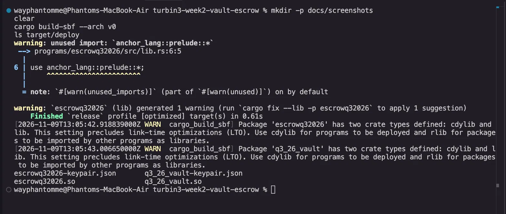
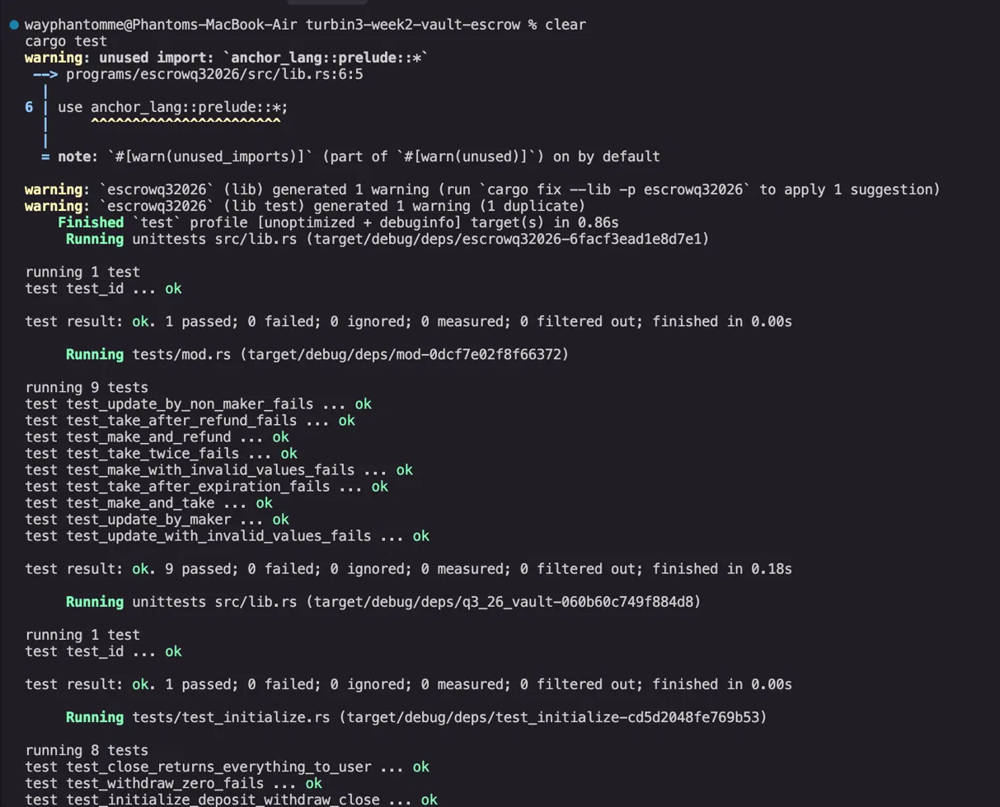
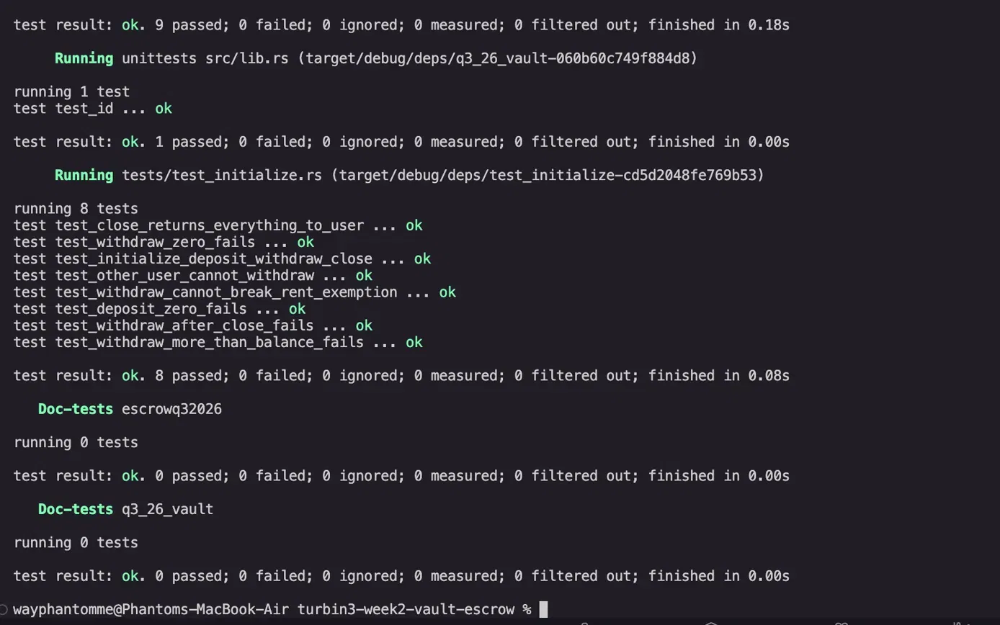
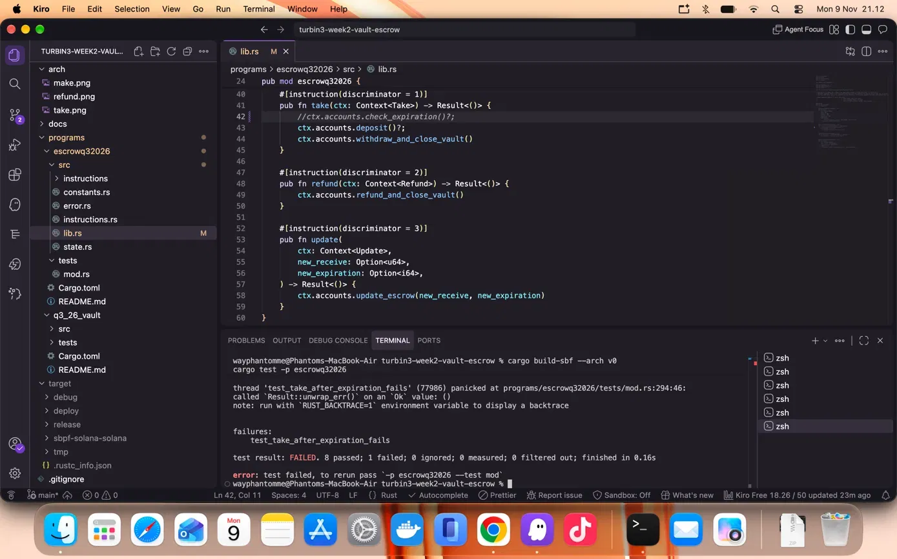
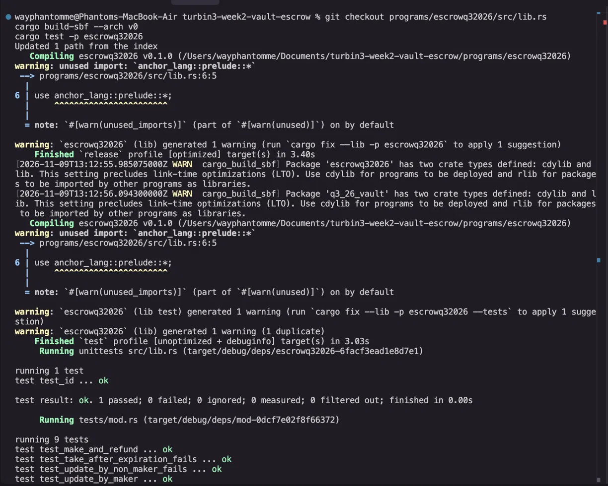
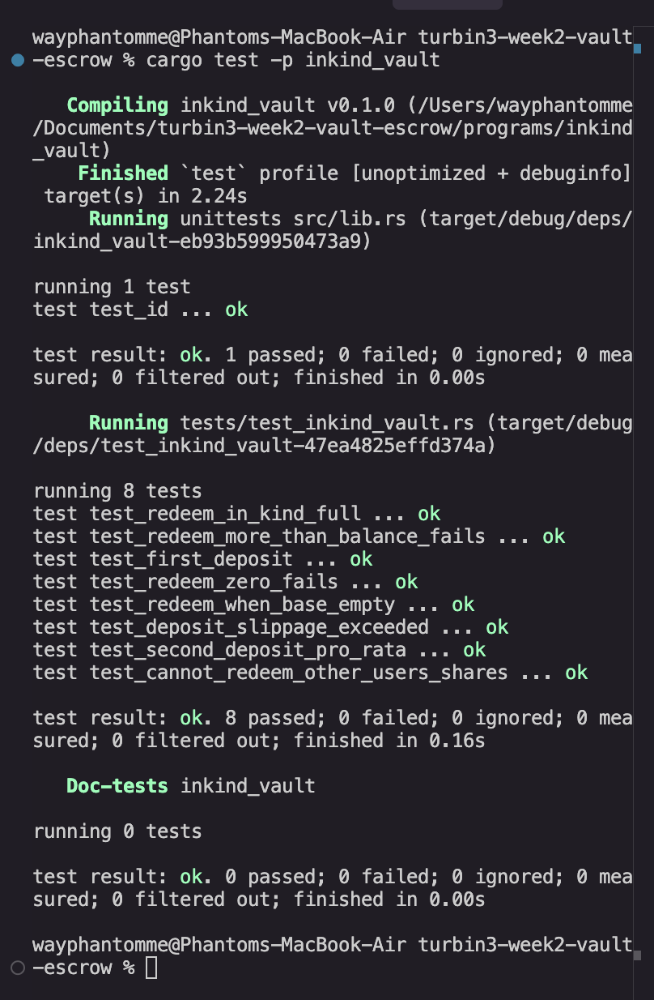

# Turbin3 Builders Cohort Q4 2026 — Week 2: Vault & Escrow

Two Anchor programs in one workspace, tested with [LiteSVM](https://github.com/LiteSVM/litesvm).

| Program | Path | What it does |
|---|---|---|
| **Vault** | [`programs/q3_26_vault`](programs/q3_26_vault) | A personal SOL vault per user: `initialize`, `deposit`, `withdraw`, `close` |
| **Escrow** | [`programs/escrowq32026`](programs/escrowq32026) | A trustless token swap with a deadline: `make`, `take`, `refund`, `update` |

## Assignment checklist

- [x] Vault with `withdraw` and `close`
- [x] Escrow with `make`, `take`, `refund`, `update`
- [x] Tests for every instruction, including failure cases (LiteSVM, Rust)
- [x] Optional: timed escrow using the Clock sysvar (`expiration`)

## Quick start

Requirements: Rust 1.89.0 (pinned in `rust-toolchain.toml`), Solana CLI and Anchor CLI.

```bash
git clone https://github.com/wayphantomme/turbin3-week2-vault-escrow
cd turbin3-week2-vault-escrow
anchor keys sync                 # only needed if program ids do not match your local keypairs
cargo build-sbf --arch v0        # builds both programs into target/deploy
cargo test                       # runs the LiteSVM tests of both programs
```

> The tests load the compiled `.so` files from `target/deploy`, so run `cargo build-sbf` before `cargo test`
> (and again after every change to a program).

## Vault

Every user gets two PDAs derived from their wallet:

| Account | Seeds | Purpose |
|---|---|---|
| `vault_state` | `["state", user]` | Stores the two bumps |
| `vault` | `["vault", user]` | A system account that holds the SOL |

| Instruction | Behaviour |
|---|---|
| `initialize` | Creates `vault_state` and funds the vault with the rent-exempt minimum |
| `deposit(amount)` | Transfers SOL from the user to the vault. `amount` must be > 0 |
| `withdraw(amount)` | The vault PDA signs a transfer back to the user. Fails if `amount` is 0 or if the vault would drop below the rent-exempt minimum |
| `close` | Sends every lamport in the vault back to the user and closes `vault_state` (its rent goes back to the user too) |

Only the owner can touch a vault: all seeds include the signer's key, so another wallet cannot derive the same accounts.

## Escrow

A maker locks token A and asks for an amount of token B. Any taker holding token B can complete the swap atomically.

```
make    maker --token A--> vault (PDA-owned)
take    taker --token B--> maker        vault --token A--> taker      (vault + escrow closed)
refund  vault --token A--> maker                                      (vault + escrow closed)
update  maker changes `receive` and/or `expiration` while the escrow is open
```

| Instruction | Discriminator | Behaviour |
|---|---|---|
| `make(seed, deposit, receive, expiration)` | 0 | Creates the escrow and vault, deposits token A. `deposit` and `receive` must be > 0 and `expiration` must be in the future |
| `take` | 1 | Fails after `expiration`. The taker pays `receive` token B to the maker, the escrow PDA signs to send all token A to the taker, then the vault and escrow are closed. Missing token accounts are created |
| `refund` | 2 | Only the maker. Returns token A and closes the vault and escrow. Allowed at any time, also after expiration |
| `update(new_receive?, new_expiration?)` | 3 | Only the maker. Both fields are optional. `new_receive` must be > 0 and `new_expiration` must be in the future |

Accounts and custom 1-byte discriminators:
- `Escrow` PDA: `["escrow", maker, seed (u64 LE)]`, account discriminator `1`.
- The vault is the escrow's associated token account for token A.
- Time comes from `Clock::get()?.unix_timestamp`, which is an `i64`, so `expiration` is an `i64` too.

## Tests

`cargo test` runs:

**Vault** (`programs/q3_26_vault/tests`)
- full flow: initialize, deposit, withdraw, close
- deposit of 0 fails, withdraw of 0 fails
- withdraw more than the balance fails
- withdraw cannot break rent exemption (and withdrawing exactly the deposit works)
- another user cannot withdraw from someone else's vault
- close returns deposit and rent to the user
- withdraw after close fails

**Escrow** (`programs/escrowq32026/tests`)
- make and refund
- make and take (balances of both sides, accounts closed)
- take after expiration fails (clock moved with `set_sysvar`) and the maker can still refund
- take after refund fails, take twice fails
- update by the maker (both fields, one field, take uses the new price)
- update by a non-maker fails, update with invalid values fails
- make with invalid values fails

## Challenge #5 — Non-custodial in-kind vault (`inkind_vault`)

> **Program:** [`programs/inkind_vault`](programs/inkind_vault)

### Design

A pooled vault that holds two assets — a **base token** (liquid, e.g. USDC) and a **position token** (market receipt, e.g. an LP or lending receipt) — and issues fungible **share tokens** as claims against both.

| Property | How it is enforced |
|---|---|
| Non-custodial | No `authority` field in state. The only signer that can move assets out is the vault PDA, and only inside `redeem_in_kind` after burning shares |
| Redeem in kind | Output = pro-rata slice of **both** base and position, atomically |
| No liquidity requirement | No idle-balance check. If `base_vault` is empty the user still receives their share of position tokens and can unwind the market themselves |
| Exit any time | No pause, lockup, cooldown, or admin gate |
| Oracle-free pricing | Deposit cost = `ceil(shares × balance / supply)` — pure on-chain arithmetic |
| Anti-inflation attack | First deposit mints `MINIMUM_SHARES` to the vault's own ATA (authority = vault PDA, no private key). Those shares are permanently locked — no one can sign a burn for that account. This raises the cost of a share-price inflation attack from near-zero to at least `MINIMUM_SHARES` units of base token |

### Instructions

| Instruction | Parameters | Behaviour |
|---|---|---|
| `initialize` | — | Creates the vault state, share mint (authority = vault PDA), and two vault-owned ATAs |
| `deposit(shares, max_base, max_position)` | `shares` ignored on first deposit | First call sets the ratio; later calls compute required amounts pro-rata (rounded up). Rejects if required > max |
| `redeem_in_kind(shares)` | — | Burns shares, transfers `floor(shares × balance / supply)` of each asset to the caller. ATAs created with `init_if_needed` |

### Trust assumptions (be honest in production)

1. **Program must be made immutable after deploy.** If the upgrade authority is still held, the logic can be changed. Run `solana program set-upgrade-authority <PROGRAM_ID> --final` after deployment.
2. **Mint freeze authority.** If the base or position mint has a freeze authority (e.g. USDC), the issuer can freeze the vault's ATA. This is outside the program's control and should be disclosed to users.

### Tests (`programs/inkind_vault/tests/test_inkind_vault.rs`)

1. First deposit mints `max_base` shares to user + `MINIMUM_SHARES` to vault's own locked ATA; vault holds full deposit
2. Second deposit is correctly pro-rata (rounded up)
3. Full redeem returns proportional base and position tokens
4. **Key case**: redeem succeeds even when `base_vault` balance is zero — user receives position tokens and exits without idle liquidity
5. Redeem of 0 shares fails
6. Redeem more than balance fails
7. Another user cannot burn someone else's shares
8. Deposit with `max_*` too tight fails `SlippageExceeded`

## Screenshots

### Build

`cargo build-sbf --arch v0` — both programs compile to `.so` (1 warning: unused import, harmless).



### Escrow tests — all 9 passed

`cargo test` — escrow suite: 9 passed, 0 failed.



### Vault tests — all 8 passed

Vault suite: 8 passed, 0 failed.



### Failure case — expiration check commented out

`test_take_after_expiration_fails` panics when `check_expiration()` is commented out in `lib.rs`. This confirms the guard is real and the test actually catches the missing check.



### Fixed — all tests green

After restoring `lib.rs` with `git checkout`, rebuild and retest: 9/9 escrow tests pass including `test_take_after_expiration_fails`.



### In-kind vault tests — all 8 passed

`cargo test -p inkind_vault` — 8 passed, 0 failed.



## What I learned

**PDAs as signers** — the escrow PDA owns the vault token account, so it can sign the transfer to the taker without any private key. The vault PDA does the same for the SOL vault. Getting the seeds and bumps right, and passing them through `invoke_signed`, is the core mechanic of both programs.

**Custom 1-byte discriminators** — Anchor's default 8-byte discriminator can be overridden with `#[instruction(discriminator = N)]`. Smaller on-chain footprint and a useful exercise in understanding how the router distinguishes instructions.

**The Clock sysvar** — `Clock::get()?.unix_timestamp` returns an `i64`. The expiration field in the escrow is therefore `i64`, not `u64`. LiteSVM's `set_sysvar` lets tests fast-forward the clock to trigger `test_take_after_expiration_fails` without waiting in real time.

**Testing failure cases** — a test that only checks the happy path is incomplete. Commenting out `check_expiration()` and watching the test fail proved the guard does real work. Each negative test (`_fails`) uses `assert!(result.is_err())` and ideally matches the specific error variant.
